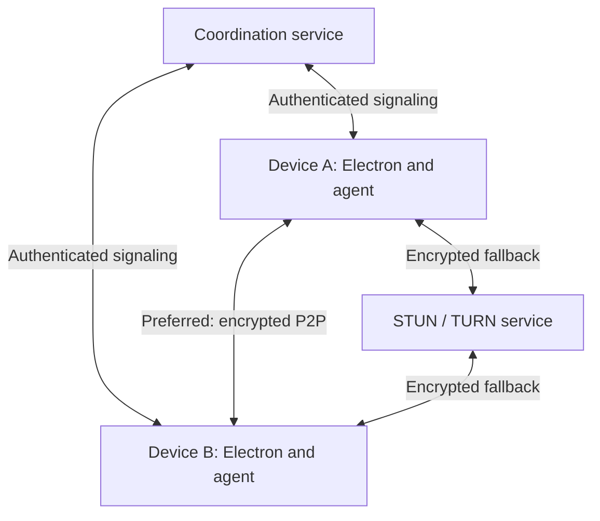

# Architecture decision — accepted 7 October 2026

## Confirmed user requirements

1. Desktop control in either direction between authorized devices.
2. Electron packages for Windows, Ubuntu and macOS Intel/Apple Silicon; ARM64
   Linux targets including supported Raspberry Pi and Jetson configurations.
3. Automatic quality adjustment and user-selectable clear-text/smooth modes.
4. Real SSH between devices.
5. Bidirectional resumable file transfer.
6. Strong security and a documented vulnerability assessment process.
7. Saved devices for easy reconnection.
8. P2P with relay fallback and unattended access.
9. Complete OS-specific installation packages for end users.

## Topology

The coordinator helps devices authenticate, discover presence and exchange
connection offers. TURN forwards encrypted session packets only if needed.
It is not a desktop session termination server. Both peers authenticate the
session against their pinned device identities; TLS signaling alone is not
sufficient protection against a compromised coordinator replacing peer keys.

The coordinator can observe account/device metadata and connection timing.
TURN can observe addresses, traffic sizes and timing. E2E encryption does not
hide this metadata or protect an already compromised endpoint.

## Components and ownership

| Component | Technology | Boundary |
| --- | --- | --- |
| UI | Electron, React planned | No direct privileged APIs or remote code |
| Native agent | Rust, OS-specific adapters | Enforces host grants and executes approved operations |
| Media/data | WebRTC | Negotiated encrypted direct or TURN transport |
| Coordinator | Node.js / JavaScript | Registration, presence, pairing, signaling, session metadata |
| Relay | coturn | Expiring credentials, quotas, restricted destination ranges |
| Device records | SQLite planned | Bookmarks separate from trusted peer grants |
| Secrets | OS secret store / protected service store | Keys never exposed to renderer or logs |

Phase 1's JSON bookmarks and plain HTML shell are intentionally temporary.
The Node policy module is an executable reference, not the final Rust enforcement
boundary. Port the rules and the same test vectors before enabling host access.
The runtime must establish authenticated peer identity itself; it must never
accept a client-supplied authenticated=true flag.

## Connection sequence

1. Start device agent and authenticate with a unique device identity.
2. Resolve the requested device ID; an ID is a locator, not a credential.
3. Request attended approval or present a previously provisioned unattended grant.
4. Host checks permission scope, trusted identity, validity and revocation.
5. Authenticate and bind the WebRTC session to the paired device keys.
6. ICE attempts suitable direct routes and TURN candidates; display the selected
   route in the UI. Direct/relay-only diagnostic modes support testing.
7. Open only the permitted channels. Host enforces permissions for operations,
   not just at connection establishment.
8. On disconnect, release input keys, stop capture, close SSH forwarding and
   checkpoint file transfer. Reconnect requires renewed authorization.

No promise of universal firewall traversal or zero interruption is made.
LAN-only authenticated pairing is a later feature, not present in this package.

## Media and data

- Auto, Clear text, Smooth motion and Low bandwidth modes.
- Tune resolution/frame rate/bitrate from measured bandwidth, RTT, loss and
  encoding load. Hardware encoding is a tested capability, not an assumption.
- Reliable ordered transport for keys/buttons, SSH and files; coalesce mouse
  motion. Reset pressed inputs on focus/session loss to avoid stuck keys.
- Backpressure and quotas across data channels; file transfer must not starve
  control traffic. Test contention rather than assuming channel priority suffices.
- File transfers use bounded chunks, authenticated manifests, integrity checks,
  resumable offsets and temporary files before final rename. Normalize paths,
  enforce allowed roots and defend against symlink/race traversal.
- SSH retains SSH host-key checks and user authentication. Forward only to an
  approved local SSH service; do not create unrestricted LAN port forwarding.
- Local sleep/offline devices are unavailable. Wake-on-LAN is outside initial scope.

## Hosting and bandwidth

Self-host coordination and coturn on Utho. Start with a dedicated development
instance or clearly isolated services; do not modify the existing IoT services.
An initial small VM is a pilot candidate, not a capacity guarantee.

Relay capacity is driven mainly by concurrent relayed bitrate. A one-way
4 Mbit/s stream produces about 1.8 GB/hour relay egress and a similar ingress
volume, before overhead. Billing treatment must be checked with the provider.
Do not promise session counts until load and network measurements exist.

Use HTTPS/WSS on the coordinator. TURN needs its own UDP/TCP/TLS listeners and
relay port range; ordinary Nginx HTTP proxying does not proxy TURN.
If TURN/TLS on 443 is required, use a dedicated IP or explicitly engineered
L4 routing. Do not bind it over the existing HTTPS service.

## Platform and installer gates

| Target | Package goal | Required validation |
| --- | --- | --- |
| Windows x64 | Signed EXE installer | Input, DPI, multiple monitors, service/session boundaries, UAC |
| Ubuntu x64 | DEB | X11 and Wayland tested independently, desktop permissions |
| macOS Intel | Signed/notarized DMG or PKG | OS floor, capture/Accessibility permissions, launch agent |
| macOS ARM64 | Native signed/notarized package | Same tests on Apple Silicon hardware |
| Raspberry Pi ARM64 | DEB and headless agent | Exact model/OS, graphics session, encoder performance |
| Jetson | Conditional native package | Exact model, JetPack, glibc and graphics stack compatibility |

Background service availability does not imply login-screen or preboot control.
Windows secure desktop, macOS FileVault/prelogin, and Wayland consent limitations
must be documented per tested platform. Initial desktop sessions target a logged-in
user session; headless SSH/files are separate capabilities.

End-user packages will bundle runtimes and agent binaries, configure service
startup with consent and guide OS permissions. Development commands in README
are not the final end-user installation experience.

## Sources checked during planning

- https://webrtc.org/getting-started/peer-connections
- https://webrtc.org/getting-started/turn-server
- https://www.rfc-editor.org/rfc/rfc8827.html
- https://www.electronjs.org/docs/latest/tutorial/security
- https://www.electronjs.org/docs/latest/api/desktop-capturer
- https://flatpak.github.io/xdg-desktop-portal/docs/doc-org.freedesktop.portal.RemoteDesktop.html
- https://github.com/coturn/coturn/blob/master/examples/etc/turnserver.conf

Recheck versions and OS support before locking release dependencies.
